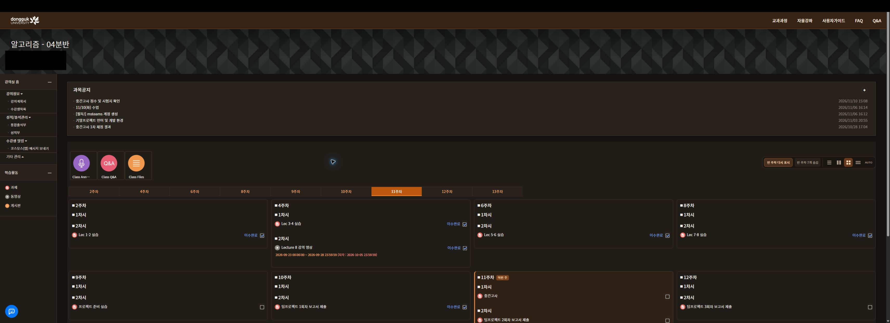
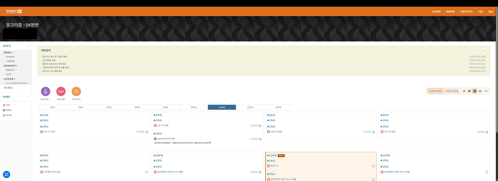

# Dongguk e-Class

동국대 e-Class에 **사이트 다크 모드**를 제공하고, **과제·동영상 학습 현황을 작은 Chrome 팝업에 모아 보는** 비공식 확장프로그램입니다. 전체 주차 보기와 그리드 배열로 강의실도 읽기 쉽게 정리합니다.

[최신 버전 다운로드](https://github.com/gomgi851/dongguk-eclass-extension/releases) · [버전별 변경 내역](CHANGELOG.md) · [설치·사용 안내](docs/USAGE.md) · [문제 제보](https://github.com/gomgi851/dongguk-eclass-extension/issues)

> 초기 베타입니다. 동국대학교가 제작하거나 공식 제공하는 프로그램이 아닙니다. 과제 제출·출석의 최종 상태는 학교 사이트에서 확인하세요. Chrome 웹 스토어에는 아직 게시되지 않았습니다.

## 핵심 기능: e-Class 다크 모드

**학교 사이트 자체를 어두운 테마로 바꿀 수 있습니다.** 메인, 강의실, 과제, 출석부·성적부, 게시판 목록·글 상세 등의 배경·글자·구분선 색상을 보정합니다.

- **사이트 다크 모드:** e-Class 페이지 상단의 스위치로 켜고 끕니다.
- **팝업 다크 모드:** 확장 팝업 상단의 해·달 토글로 바꿉니다.
- 두 테마는 **각각 따로 저장**되어, 사이트와 팝업을 원하는 조합으로 사용할 수 있습니다.
- 사이트 테마 설정은 이미 열린 e-Class 탭에도 반영됩니다. 학교 페이지 구조에 따라 일부 영역은 추가 보정이 필요할 수 있습니다.

## 실제 사용 화면

실제 로그인된 계정에서 확장이 적용된 강의실을 촬영했습니다. 예시 데이터가 아니며, 공개용 이미지에는 이름·학번·IP 등 개인정보 영역만 촬영 후 단색으로 가렸습니다. 화면은 촬영 시점의 상태입니다.

### 다크 모드 · 빈 주차 숨김 · 4열 그리드



### 라이트 모드 · 현재 주차 강조



## 제공 기능

| 영역 | 기능 |
| --- | --- |
| **e-Class 사이트 다크 모드** | **학교 사이트의 배경·글자·구분선 색상 보정. 사이트 상단 스위치로 ON/OFF** |
| **팝업 라이트·다크 모드** | **팝업 상단 해·달 토글 제공. 사이트 테마와 별도로 저장** |
| 과제 | 미제출 / 제출함 / 전체, 마감일과 D-day, 기간별 필터 |
| 제출한 과제 | 제출 후에도 목록에서 열기 가능. 수정 가능 여부는 강좌 설정에 따름 |
| 동영상 | 개별 출석부를 기준으로 미수강 / 수강함 구분, 확인 가능한 경우 요구시간까지 남은 학습시간 표시 |
| 확인 작업 | 강좌 선택, 진행·완료·중지·로그인 만료 안내, 팝업을 닫아도 수집 계속 |
| 일부 실패 | 이전 결과를 유지하고 오래된 결과와 확인 실패를 표시 |
| 확인 필요 | 판별되지 않은 과제·미지원 학습 자료의 개수와 바로 보기. 미지원 형식의 출석을 완료로 추정하지 않음 |
| 주차 보기 | 전체 주차 펼치기, 빈 주차 숨기기, 목록·2열·4열·8열·AUTO 배열 |
| 현재 주차 | 학사 기간을 확인할 수 있으면 이번 주 강조. 확인 불가 시 선택된 주차로 구분 |
| 편의 | 글꼴 내장, 설정 저장, 업데이트 내역과 팝업 CSP 진단 표시 |

## 설치

**Chrome 116 이상**에서 사용합니다. Node.js나 Python은 일반 사용자 설치에 필요하지 않습니다.

1. [Releases](https://github.com/gomgi851/dongguk-eclass-extension/releases)에서 `dongguk-eclass-버전.zip`을 받습니다. GitHub가 자동 제공하는 `Source code` ZIP보다 이 파일을 권장합니다.
2. 압축을 해제합니다. `manifest.json`이 바로 들어 있는 폴더가 확장 폴더입니다.
3. Chrome 주소창에서 `chrome://extensions`를 열고 **개발자 모드**를 켭니다.
4. **압축해제된 확장 프로그램을 로드합니다**를 누르고 해당 폴더를 선택합니다.
5. 확장 아이콘을 고정한 뒤, [e-Class](https://eclass.dongguk.edu/)에 로그인합니다.

소스 저장소를 내려받았다면 **`extension/` 폴더**를 로드하세요. 저장소 루트가 아닙니다.

## 시작하기

1. 확장 아이콘 → 설정 → 강좌 설정 → **강좌 불러오기**
2. 확인할 강좌를 선택하고 **선택 강좌 확인**
3. 과제·동영상과 제출 상태를 골라 확인합니다. 이후 화살표 아이콘으로 갱신합니다.
4. 모든 주차 보기는 팝업 설정에서 켭니다. 빈 주차 숨김과 그리드 버튼은 강의실 안에 표시됩니다.
5. 사이트 다크 모드는 e-Class 상단에서, 팝업 테마는 팝업 상단에서 바꿉니다.

업데이트할 때는 기존 확장 폴더의 파일을 교체한 뒤 확장 관리 화면에서 **새로고침**, 열린 e-Class 페이지도 **새로고침**하세요. 기존 확장을 제거하면 저장 데이터가 삭제될 수 있습니다.

## 알아둘 범위

- **퀴즈·설문·Teams 강의·공지로만 안내되는 과제는 집계하지 않습니다.**
- `econtents`·SCORM 등 감지한 미지원 학습 형식은 동영상의 **확인 필요**에 표시합니다. 출석 상태를 자동 판단하는 지원과는 다르며 학교에서 직접 확인해야 합니다.
- 결과는 마지막 확인 시점 기준입니다. 모르는 형식이나 실패를 완료로 간주하지 않습니다.
- 과제 제출, 영상 재생, 이수·출석 상태 변경을 자동으로 수행하지 않습니다.
- 학교 페이지 구조·강좌 구성에 따라 수집과 화면 보정이 일부 적용되지 않을 수 있습니다.
- CSP 오류는 현재 코드의 로컬 재현 환경에서 차단 0건을 확인했지만, 보고된 설치 환경의 원인은 아직 확정하지 못했습니다. [문제 해결](docs/TROUBLESHOOTING.md)을 참고하세요.

## 데이터와 권한

학습 결과와 설정은 `chrome.storage.local`에 저장합니다. 별도 개발자 서버·광고·분석 추적 코드는 없습니다. 학교 서버에는 기존 로그인 세션으로 페이지를 요청합니다. 계정 구분을 위해 학번을 읽어 SHA-256 해시로 변환한 값을 로컬에 저장하며, 해시를 익명 정보라고 보장하지 않습니다.

| 권한 | 용도 |
| --- | --- |
| `storage` | 학습 결과, 강좌 선택, 테마·필터·주차 보기 설정 저장 |
| `offscreen` | 학교 HTML을 DOM으로 파싱하고 팝업을 닫아도 확인 작업 유지 |
| `https://eclass.dongguk.edu/*` | 해당 학교 사이트의 학습 페이지 읽기와 화면 보정 |

자세한 내용은 [데이터 처리 안내](docs/PRIVACY.md)를 확인하세요. 로그인 정보, 학번, 실명, 성적, 과제 파일, 페이지 원문이 포함된 자료는 이슈에 올리지 마세요.

## 개발과 검증

개발 환경: Node.js 22 이상, Python 3.10 이상.

```sh
npm ci
npm test
npx playwright install chromium
npm run test:browser
python scripts/package.py
```

배포 ZIP은 `dist/`에 생성됩니다. 합성 HTML·모의 Chrome API 테스트로 수집 로직을 검사하고, 별도 Chromium 테스트에서는 **실제 MV3 확장**을 임시 프로필에 로드해 팝업·설정·수집·CSP와 라이트/다크 그리드의 넘침·제목 폭·제한 안내 위치·게시글 색상 복원을 검사합니다. 학교 네트워크 응답은 합성 자료로 대체하며 개인 계정은 쓰지 않습니다. 검사 결과의 화면·실패 추적은 GitHub Actions의 `browser-validation` 첨부 파일에서 확인합니다. 모든 실제 강좌·학교 CSS·설치 환경을 검증한 것은 아니며, 픽셀 단위 스크린샷 기준 비교는 아직 포함하지 않습니다.

```text
extension/          Chrome에 로드할 확장 소스와 글꼴·아이콘
tests/              개인 학습 데이터가 없는 합성 테스트
scripts/            버전 갱신과 ZIP·릴리스 노트 생성
docs/               사용법, 데이터 처리, 문제 해결, 배포 절차
.github/workflows/  CI와 버전 태그 기반 Release 생성
CHANGELOG.md        버전별 변경 내역 원본
```

## 버전별 기록과 배포

변경 사항은 루트 [CHANGELOG.md](CHANGELOG.md)에 기록하고, GitHub Release에도 같은 버전의 내용을 싣습니다. 버전 태그를 푸시하면 테스트와 패키징 후 ZIP·체크섬을 첨부한 Release를 생성하도록 구성했습니다. 0.x는 베타 릴리스로 표시합니다. 상세 절차는 [RELEASING.md](docs/RELEASING.md)에 있습니다.

```sh
npm run version -- 0.7.4
# CHANGELOG.md의 새 항목을 작성하고 실제 Chrome에서 확인
npm test
python scripts/package.py
git add .
git commit -m "Release v0.7.4"
git tag v0.7.4
git push origin main
git push origin v0.7.4
```

이 자동화는 GitHub 배포만 처리하며 Chrome 웹 스토어 제출은 하지 않습니다.

## 글꼴과 라이선스

UI에는 ㈜여기어때컴퍼니의 **여기어때 잘난체 2** 원본을 포함합니다. [저작권·재배포 안내](extension/licenses/FONT-NOTICE.md)와 [공식 라이선스 원문 PDF](extension/licenses/Jalnan-Official-Guide.pdf)를 함께 배포합니다. 아이콘은 직접 제작했으며 학교 공식 로고가 아닙니다.

이 저장소의 확장 코드에 대한 별도 오픈소스 라이선스는 아직 지정하지 않았습니다. 글꼴의 이용 조건은 코드와 별도로 적용됩니다. 개발 의존성의 라이선스는 각 패키지를 따릅니다.
